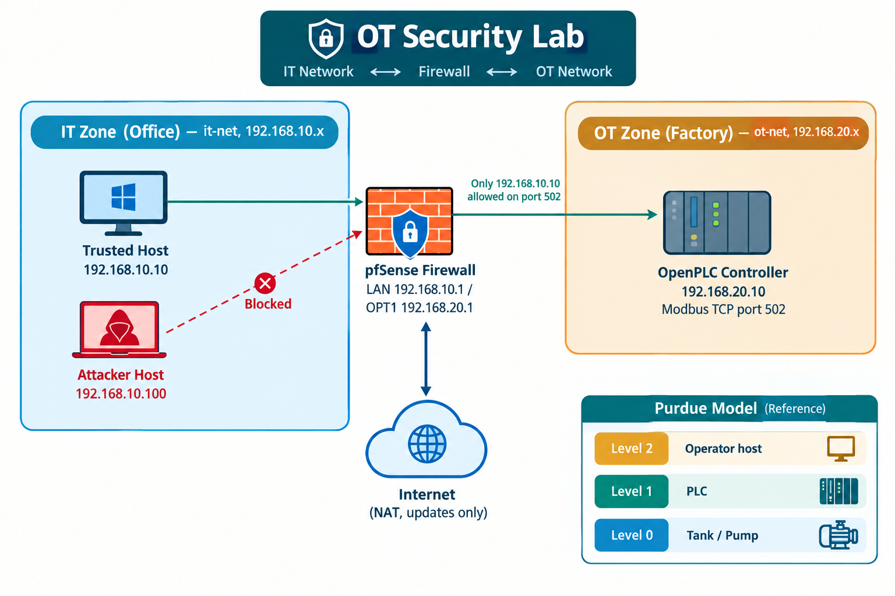
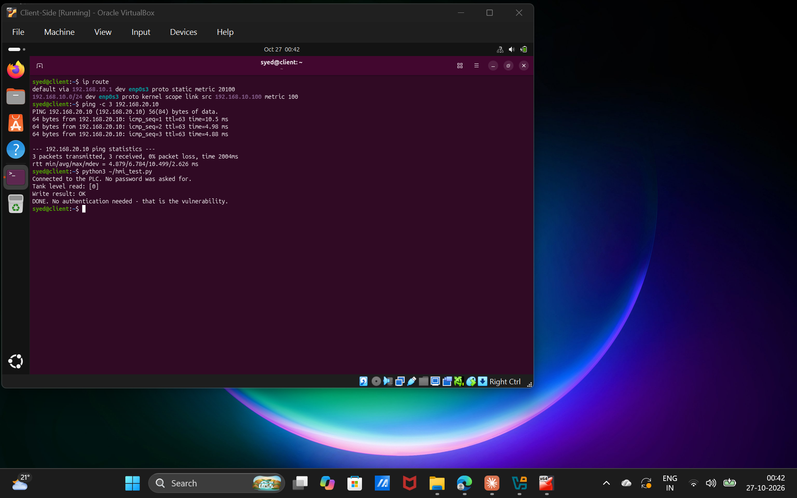
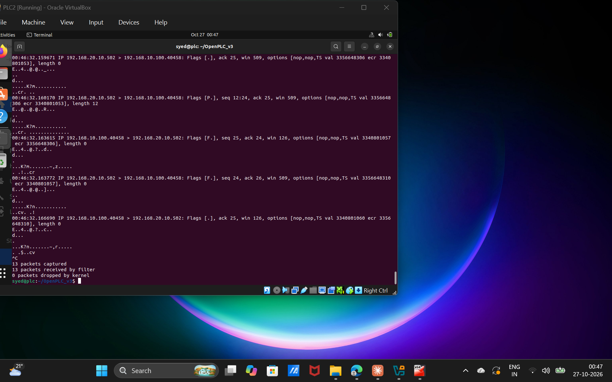
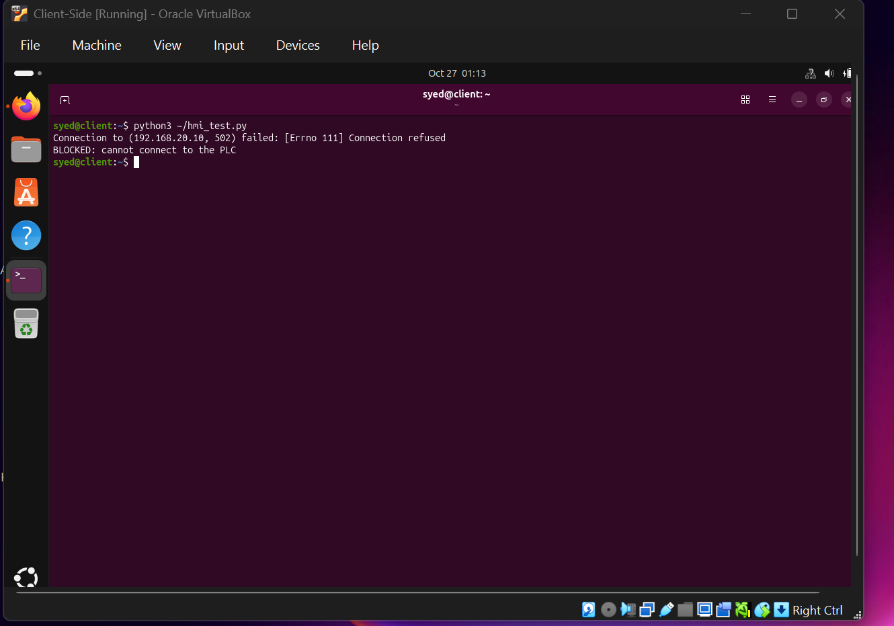

# Modbus OT Security Lab

Demonstrating and mitigating the lack of authentication in **Modbus TCP**, the protocol many industrial PLCs use. This lab builds a small simulated factory in virtual machines, proves that any computer on the network can read and change PLC values without a password, then blocks the attack with a firewall rule.

> ⚠️ **For use in your own lab only.** Everything here runs inside isolated virtual machines. Never test on a network or device you do not own.

## The idea in one line

> I built a simulated plant with an OpenPLC controller, showed that any host on the network can read and change its values over Modbus with no authentication, then added a pfSense firewall rule so only one trusted host could reach it, and showed the same attack was blocked. Mapped to the Purdue model and IEC 62443 zones and conduits.

## Architecture

```
  IT zone (it-net, 192.168.10.x)          OT zone (ot-net, 192.168.20.x)
 +-------------------------------+        +------------------------------+
 |  Trusted host    .10.10       |        |  OpenPLC (PLC)   .20.10      |
 |  Attacker host   .10.100      |        |  Modbus TCP on port 502      |
 +---------------+---------------+        +---------------+--------------+
                 |                                        |
                 |          +--------------------+        |
                 +--------->|  pfSense firewall  |<-------+
                            |  LAN 192.168.10.1  |
                            |  OPT1 192.168.20.1 |
                            +--------------------+
```

The firewall is the only path between the office (IT) and factory (OT) zones.

## Tools

| Tool | Role |
|---|---|
| VirtualBox | Runs the lab as isolated VMs |
| pfSense CE 2.7.2 | Firewall between the IT and OT zones |
| OpenPLC Runtime v3 | Simulated PLC running tank-level logic |
| Python + pymodbus | Test client that reads and writes the PLC |
| tcpdump | Captures the Modbus traffic as proof |

## What it shows

**Before the firewall rule** — the untrusted host reads and writes the PLC with no password:

```
Connected to the PLC. No password was asked for.
Tank level read: [0]
Write result: OK
DONE. No authentication needed - that is the vulnerability.
```

**After the firewall rule** — only 192.168.10.10 may reach the PLC on port 502; the untrusted host is blocked:

```
Connection to (192.168.20.10, 502) failed: [Errno 111] Connection refused
BLOCKED: cannot connect to the PLC
```

## How to run the test client

On a host that can reach the PLC:

```bash
pip install pymodbus
python3 hmi_test.py
```

`hmi_test.py` connects to the PLC at 192.168.20.10:502, reads the tank level, and writes a new value — all without authentication, which is the point.

## Standards mapping

- **Purdue model** — tank/pump = Level 0, PLC = Level 1, operator host = Level 2, office host on the IT side; the firewall sits between the levels.
- **IEC 62443 zones & conduits** — OT and IT zones are separated; the pfSense rule is the single controlled conduit.
- **NIST CSF** — Identify (asset list), Protect (the firewall rule), Detect (tcpdump and firewall logs).

## Limitations

- An IP address can be spoofed; a single-IP allow rule is a start, not full protection.
- If the trusted host is compromised, commands can still be sent through it.
- Modbus remains unencrypted.
- A real plant adds VLANs, VPN, deep inspection (read-only Modbus), and monitoring.

## Screenshots

**Network architecture**



**Attack succeeds (before the firewall rule)** — the untrusted host reads and writes the PLC with no password:



**Packet capture** — tcpdump on the PLC shows the Modbus traffic from 192.168.10.100, no authentication:



**Firewall rule** — only the trusted host may reach the PLC on port 502:


**Attack blocked (after the firewall rule):**



More in the `screenshots/` folder: the VM list and the OpenPLC dashboard. A full write-up is in `Modbus-OT-Security-Lab-Report.docx`.

## Author

**Syed Umar** — [GitHub](https://github.com/TheSyedUmar)
